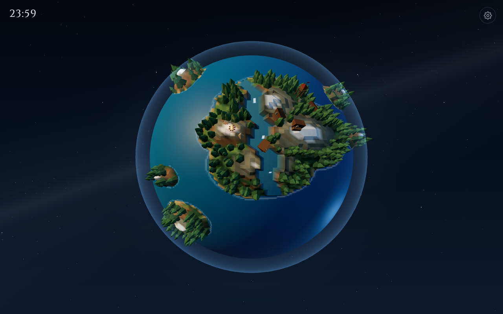

# 文明专注 · V0.4 时代精修与奖赏版

> 点击地球，拉近、转场，进入你的文明场景开始一轮安静的学习；每完成一轮，文明与奖赏一同生长。

面向大学生自习场景的番茄钟。首页只保留本地时间、设置按钮与一颗可交互的体素地球；点击地球会**拉近镜头并像素转场**进入当前文明的像素场景，在场景中的石牌/木牌/铁牌 HUD 上计时。完成 1 轮解锁盛唐，完成 2 轮开放蒸汽城镇；场景、地球、时钟字体、首页背景同步演进，并解锁图鉴、环境音等奖赏。



## 本轮完成（V0.4）

### 三个时代的精修场景

- **石器聚落 / 盛唐田园 / 蒸汽城镇**：1280×720 逻辑像素画布，cover 适配任意视口；底图为登记在册的 far/mid/near 分层像素素材（`src/assets/scenes/<era>/`），经量化管线统一像素网格与色阶；加载失败自动回退程序化底图，不黑屏、不阻断计时。
- 动态层继续代码绘制：篝火/炊烟/火星、水车/水光/小舟、火车/烟囱/蒸汽，以及各时代村民活动；单一主光方向、接触阴影、远中近三层景深。
- **蒸汽城镇全链路开放**（完成 2 轮）：砖砌厂房、双烟囱、钟楼、车站雨棚、煤堆、环大陆铁轨与运河货船；工业地球（煤灰地表）、Share Tech Mono 工业时钟、进度节点可点击，未达轮数不显示假入口。
- 每时代 3 个发光图鉴热点（共 9 个），点击打开图鉴弹窗；减少动态偏好下全部动画静止、转场瞬时切换。

### 奖赏系统

- **图鉴面板**：场景工具区入口，按时代标签浏览已解锁图鉴；每时代 3 张卡片，插图为运行时从合成底图裁切的真实场景切片（240×160），不打包额外插画。
- **解锁庆祝卡**：仅在跨越解锁阈值的轮次结算后出现一次；只列真实新增内容（图鉴恒有，背景/环境音仅当可用）；刷新不重复弹。
- **首页背景三款**：银河星空（石器）/ 极光天幕（盛唐）/ 深空星云（工业），随时代自动应用，静态种子化绘制，无持续动画。
- **环境音三段**：森林鸟鸣 / 田园流水 / 柔和蒸汽，全部本地合成并实测响度（约 -20 LUFS）、无缝循环；默认关闭、无首屏音频请求，用户手势开启；总开关 / 静音 / 单一音量 / 可更换，500ms 交叉淡化；刷新保留偏好但需点击恢复；自动播放被拒有可见重试。
- **完成提示音**：Web Audio 合成两声短音，遵守全部声音设置。

### 极简首页 + 体素地球 + 转场（沿用并验证）

- 左上角设备本地时间 `HH:mm`（每秒校准），右上角齿轮设置；其余只有居中地球，无滚动条。
- 地球为真实 Three.js 球体：阶梯状体素地形、雪顶山、河流瀑布、海岸浪沫、实例化森林与各时代建筑；缓慢自转 + 拖拽旋转；点击判定只认球面投影内的轻触。
- 转场序列：镜头推近 → 像素块溶解覆盖 → 切换场景 → 散开揭示 → HUD 分级入场；返回为反向序列，计时全程不中断。
- 时钟字体随时代：Cinzel / Ma Shan Zheng / Share Tech Mono，**仅字体变化，无边框/底板/装饰**。

### 计时 / 设置 / 数据（沿用并验证）

- 默认 25/5；设置弹窗校验正整数、持久化、只影响新轮次；当前轮次不受修改影响。
- 截止时间计时、暂停/刷新/切回前台恢复、唯一轮次一次性结算、完成解锁推导。
- 旧存档兼容（无 settings 回落 25/5）；演示数据隔离不读取；存储不可用时降级提示。
- 声音偏好独立存储 `wmf:v1:audio`，损坏只回退声音偏好，不影响进度。

## 快速开始

环境：Node.js ≥ 20.19（实测 24.x）。

- Windows 双击 **`启动.bat`**：检查依赖 → 构建 → 预览 → 自动开浏览器。
- 命令行：`npm ci && npm start`（或 `npm run dev` / `build` / `preview`）。
- 回归：`npm run preview` 后另开终端 `npm run regression`（Playwright + 系统 Chrome，默认打 `http://localhost:4173`，可用 `VERIFY_URL` 覆盖）。

## 目录结构

```text
index.html               首页 / 场景 HUD / 转场画布 / 设置·确认·图鉴·解锁弹窗
启动.bat                 Windows 一键启动
src/
  main.js                入口
  app.js                 视图与转场编排、计时结算、设置、主题同步、奖赏接线
  globe.js               Three.js 体素地球、地形/植被/建筑、缩放转场 API
  scene.js               1280×720 像素场景（三时代）与动态层、热点坐标、切片裁切
  ui.js                  HUD/进度/热点/弹窗渲染 + 像素溶解转场 (createFx)
  clock.js               时代字体本地时钟
  timer.js               截止时间计时引擎
  store.js               存档、设置校验、旧档兼容
  themes.js              时代主题集中配置（色板/字体/解锁映射）
  eras.js                时代标识、解锁规则、图鉴文案
  rewards.js             奖赏注册表（图鉴/背景/环境音，available 门禁）
  background.js          三款静态首页背景（种子化绘制 + 缓存 + 节流重绘）
  audio.js               环境音状态机、交叉淡化、完成提示音
  audio-prefs.js         声音偏好持久化（wmf:v1:audio）
  assets/scenes/<era>/   far/mid/near 分层像素底图（登记素材）
  assets/audio/          三段环境音 .ogg + .m4a（本地合成）
  assets/fonts/          Cinzel / Ma Shan Zheng / Share Tech Mono 子集 + OFL 许可
  styles.css             星空、时钟、牌匾 HUD、进度条、图鉴/解锁弹窗、转场、响应式
tests/
  regression.mjs         常驻回归套件（76 项）
tools/
  asset-pipeline.mjs     底图量化/抖动管线
  audio-forge.mjs        环境音合成/响度/无缝循环/编码工具链
  verify-*.mjs           移动端/解锁/背景专项验证
  shoot-v04.mjs          文档截图重拍脚本
docs/
  assets-register.md     素材逐项登记（来源/许可/AI 参与）
  AI-DISCLOSURE.md       AI 参与披露（含逐字提示词）
  verification.md        验证记录
  screenshots/           实际运行截图
DESIGN.md / requirements.md
```

## 字体与素材

- Cinzel、Ma Shan Zheng、Share Tech Mono：Google Fonts，SIL OFL 1.1；仅数字与冒号子集，随项目打包；许可见 `src/assets/fonts/OFL-*.txt`。
- 时代场景底图：本项目 ImageGen 生成的分层像素图，经量化管线处理，逐项登记于 [docs/assets-register.md](docs/assets-register.md)；提示词逐字存档于 [docs/AI-DISCLOSURE.md](docs/AI-DISCLOSURE.md)。加载失败回退程序化底图。
- 环境音：`tools/audio-forge.mjs` 本地合成（无外部采样），BS.1770 响度实测约 -20 LUFS、峰值 ≤ -1.5 dBTP，0.4s 等功率交叉淡化无缝循环；ffmpeg 仅用于工具链编码，不是运行时依赖。
- 地球、动态设施、背景、UI 全部程序化生成（Three.js / Canvas），无运行时外链。

## 已实际验证

生产构建（`npm run build` → `vite preview`）上执行 **76 项回归，全部通过**（Chromium 无头 WebGL）：

- 首页三元素、无滚动、时钟格式；点击/轻触/键盘进入场景并开始计时；拖动与空白不误触。
- 转场后 HUD 状态与控制正确；暂停/继续/重置确认/返回首页不中断、再进入恢复同一轮次；运行/暂停刷新恢复。
- 设置默认 25/5、五类非法输入校验、保存刷新保留、当前轮不受影响；旧档无 settings 回落默认。
- 快进结算一次性完成；完成 1/2 轮后主题、地球 aria、背景、节点同步切换；解锁卡只列真实内容、刷新不重复；非解锁轮不弹卡。
- 休息流程与轮数不增；节点回看旧时代；轮数不足时节点灰化并显示真实解锁条件。
- 9 张图鉴从热点与面板阅读，切片 240×160 真实裁切；标签切换、Esc 焦点返回。
- 声音默认关闭且首屏/刷新无音频请求；手势开启播放；静音/音量/更换交叉淡化；刷新保留偏好需点击恢复；拒绝播放可见重试并可恢复；提示音 playing 响、静音/音量 0 不响。
- 三款背景静态（ checksum 一致）、尺寸变化重绘无横滚；减少动态场景像素静止。
- 390×844 与 320×568 首页无滚动、HUD/工具区完整在视口内、图鉴单列。
- PNG 全部拦截时程序化底图降级不黑屏、计时正常；WebGL 禁用时降级按钮可进入计时。
- 性能：长任务 0、rAF 间隔 p95 < 45ms；素材预算（场景底图 ≤4MB、单音频 ≤500KB）达标。
- `npm run build` 成功，Three.js 独立分包，无构建警告。

截图：`docs/screenshots/`（首页三时代、场景、完成态、图鉴面板、解锁卡、设置、移动端）。详见 [docs/verification.md](docs/verification.md)。

## 尚未验证

- Firefox / Safari / iPhone / Android / Edge 真机；字体在其他内核的渲染差异。
- 真机拖拽手感、横屏、浏览器缩放。
- 25 分钟完整真实等待（结算用短时长 + 假时钟验证）。
- Qoder Sites 公网发布与无痕验收；手动主题切换入口（本轮不做）。

## 发布到 Qoder Sites

1. `npm run build` 确认 `dist/` 完整。
2. 在 Qoder CN 项目会话中发送：「用 Qoder Sites 把当前项目发布为公网站点：静态站点，构建命令 `npm run build`，产物目录 `dist`。发布后给我公开地址。」
3. 在 Qoder 内确认公开访问，再用未登录无痕窗口打开公开地址复跑主流程。

## 后续

- 手动时代主题选择（跟随文明 / 手动），与时钟、地球、场景整套切换并持久化。
- 背景手动选择器、更多环境音与图鉴条目；沿用注册表 `available` 机制，不改动计时与解锁数据。