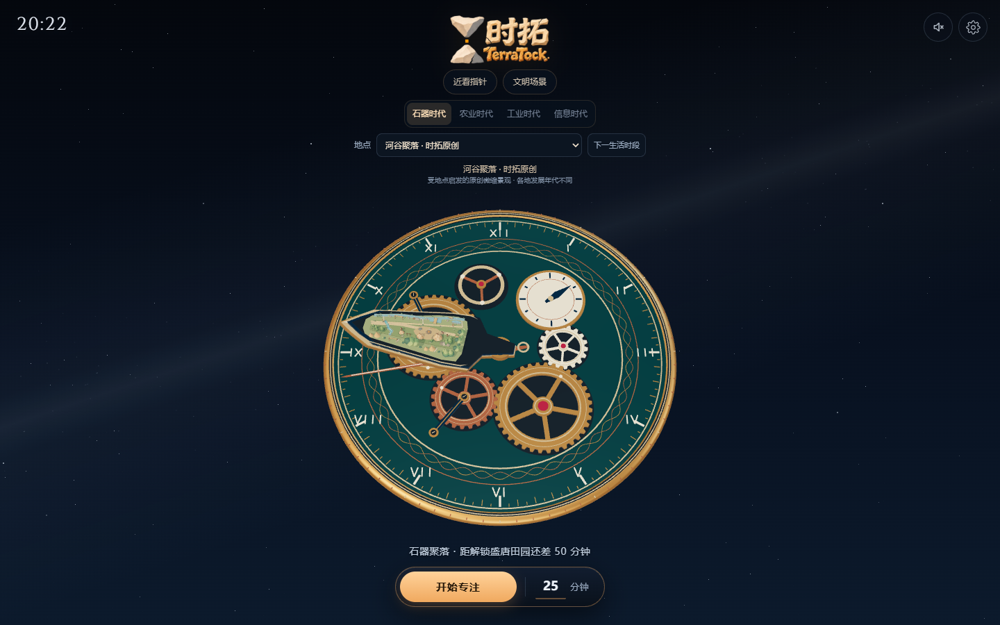
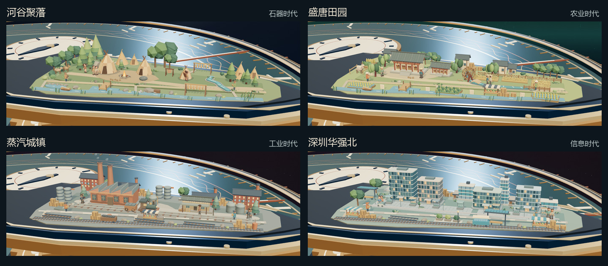

# 时拓 TerraTock · 文明专注

时拓是一款带微缩文明的番茄钟。点击首页宇宙时钟可以近看指针，按「开始专注」才开始计时。镜头跟着指针移动，指针上的居民按各地的生活日程劳作、交谈和休息。

聚落近景包含沿岸或沿线的前区、中央地标以及后方街区。滚轮或双指可继续放大至 2.6 倍，放大后左右拖动即可沿指针查看细节。键盘聚焦钟面时可用加减键缩放、左右方向键移动。

待机时宽针显示本地分钟，细针显示秒，浅色小表盘显示小时。开始专注或休息时，三针和机芯从当前位置继续走，表盘进度弧从宽针的起点展开。暂停时指针、机芯、居民和场景动画停在当前帧。运行 `node tools/build-clock.mjs` 可重新生成钟面 GLB。

- 默认专注 25 分钟、休息 5 分钟，可在设置中调整。石器时代初始开放，累计完成 50、100、150 分钟分别开放农业、工业、信息时代。
- 在首页先选时代，再选地点。四个时代共有 20 处地点，已开放时代的地点可自由切换。每个时代分别记住上次选择，地点切换和「下一生活时段」都独立于专注进度。
- 地点切换时，旧场景沉入指针台面，新场景随翻页浮现。翻页中继续选择会接续到最后选中的地点。开启系统「减少动态效果」时直接切换。真实地名是原创微缩景观的创作灵感。
- 「文明场景」入口通向前三个时代的经典像素场景。信息时代的五处地点在时钟指针上浏览。





[周口店洞穴](docs/screenshots/location-zhoukoudian-1440.png) · [尼罗河渠村](docs/screenshots/location-nile-1440.png) · [鲁尔矿区](docs/screenshots/location-ruhr-1440.png) · [深圳华强北](docs/screenshots/location-shenzhen-1440.png)

## V0.11 完成回顾（累计分钟解锁与计时反馈）

- **按真实完成分钟解锁**：石器初始开放；仅正式专注到期结算时按该轮锁定的 `run.durationMs` 增加 `progress.focusMinutes`。运行中的时间、暂停、重置、休息与演示不计入正式累计，`completedRounds` 仅保留统计与旧档迁移用途。门槛按真实值比较，不因显示舍入提前开放；单轮 100 分钟可同时开放两时代，切到蒸汽并合并通知一次。
- **统一门禁与进度**：首页、场景节点、图鉴、背景和可选环境音共享开放集合。剩余分钟指向全局下一个尚未开放时代，回看旧时代不改变资格；全部开放后仍显示真实累计并可编辑开始下一轮、使用完成态休息入口。场景进度条只按已结算正式分钟推进，50 / 100 分钟为中间 / 终点，未完成轮只由倒计时表达。
- **旧档保资格、不补造分钟**：继续使用 `wmf:v1:formal`，新增 `progress.legacyEraFloor`。仅缺字段的旧正式档按旧规则（1 轮盛唐、≥2 轮蒸汽）推导一次并随成功保存持久化；新档为 `stone`，已有字段非法也回退 `stone`，不能再按轮数补资格。最高开放时代取保留资格与真实分钟门槛的较高者；保留设置、轮次、防重结算标识与合法 `viewEra`。旧档 1 轮 / 25 分钟仍可进盛唐，但距蒸汽仍差 75 分钟；旧档 2 轮 / 50 分钟保留全部时代，累计仍为 50。进度条可保底到已开放节点，累计文字仍显示真实分钟，迁移不庆祝。
- **演示保持独立**：专注 15 秒、休息 5 秒，第 1 / 2 个完成的演示轮开放盛唐 / 蒸汽；演示文案明确标注「演示」，只在内存运行，不写正式累计与存档。
- **首页输入保存与启动**：输入草稿的 `blur` 保存失败时，同次点击不得启动，即使随后的写入恢复；保留草稿与「本地保存失败，请重试」。后续独立点击可重新校验、保存并启动（包括 Tab 失焦失败后的独立重试），不能被旧失败标记吞掉。未改设置时仍保留存储不可用可计时的降级，非法草稿不阻止地球浏览。
- **结束反馈**：首页时代说明与场景提示位置显示对应的专注完成 / 解锁 / 休息结束文字，从首次显示起保留 **4 秒**，视图往返不重置时长；按钮立即可用。自然休息到期只播放一次提示音，遵守开关、静音、音量与浏览器可播放状态；手动结束休息只有文字、无音。首页休息中右按钮及无障碍名称为「结束休息」；专注重置仍确认，取消按钮写「取消」，取消不改变原运行 / 暂停状态。
- **事件归属与防重**：反馈按正式 / 演示、轮次与阶段限定；新轮或模式切换清除旧提示，延迟转场 / 弹卡不得串模式。刷新未结算到期轮补结算一次；已完成存档刷新或迁移不重播声音与庆祝。

截图证据：[累计25分钟与剩余门槛](docs/screenshots/v11-25-remaining-1017.png) · [50分钟盛唐反馈](docs/screenshots/v11-50-unlock-320.png) · [100分钟全开放首页](docs/screenshots/v11-100-all-1017.png) · [单次保存失败](docs/screenshots/v11-save-failure-320.png)。

## V0.6 完成回顾（人物精修）

### 三时代人物精修（以用户参考图同等显示大小为交付下限）

- **三张定稿图集**（`src/assets/characters/<era>/`，33 有效帧）：48×64 格、锚点 (24,58)、idle1/walk4@5fps/work4@4fps/sit2@3fps；分层母版（头帽/躯干/前后臂/腿/手持物）派生动作，工具与手画入劳动帧，格边留透明边距。
- **造型**：石器发束侧散 + 单肩斜兽皮 + 麻绳束腰 + 露膝绑腿；盛唐宽沿竹笠三档明暗 + 檐下鬓发托脸 + 交领右衽 + 腰结 + 靛青绑腿（不镜像保右衽）；工业低冠布帽 + 卷袖亮前臂 + 马甲边 + 厚底靴。等高对照五项（头体积/脸明暗/袖手分离/腰腿/双脚）不低于参考；未标名盲测 3/3 配对正确。
- **劳动可读**：篝火旁坐姿打制（托石手稳定、锤落石芯）、田垄四帧锄地（刃入土带土屑、前倾自髋帽肩同步）、机旁扳手四帧（颚口始终压飞轮黄铜轮毂，`operate → work` 映射，回归 77d/77e 证明读取 work 行）。
- **实机尺寸**：成年人绘制倍率经 0.85/1.0 实机对比选定 1.0；篮筐/木料/鱼竿仍场景绘制并按新手位对齐；390/320 宽默认 + 全景 12 张检查溢出 0。
- **管线**：`tools/char-frames.mjs`（分层部件 + 色板）→ `tools/char-actions.mjs`（动作表 + 定稿组图）→ `make-characters.mjs` 组图器；V0.5 旧生成器隔离于 `tools/legacy/`。
- **场景零改动**：底图素材与 V0.4 底图图层顺序逐行保持（用户指令：只改人物、不动场景）；D8 后按用户反馈修正蒸汽动态层遮挡序——火车驶过覆盖轨道后方人物（77f 断言），底图不变。
- 证据：`tools/shots/v06/`（等高前后对照、盲测、深浅底边缘、实机全图与近景、三段劳动录像 webm+mp4、移动端 12 张）；最终截图副本 `docs/screenshots/v06-scene-*.png`；详见 [docs/verification.md](docs/verification.md) V0.6 节。

## V0.5 完成回顾（可靠边界 / 演示 / 人物精灵）

### 可靠边界与保存反馈（M1）

- **声音竞态修复**：播放意图令牌化——慢加载期间关闭后不再发声；连续切换只保留最终选择；过期加载失败不覆盖新状态；加载期间静音/音量变化正确生效。
- **计时边界**：到期瞬间点暂停先结算再暂停（消除零秒暂停）；转场中到期只结算一次，解锁走 pendingUnlock 不与转场并发。
- **保存失败可见反馈**：进度保存 / 声音偏好保存 / 存档读取 / 偏好读取 / 存储不可用五类通知条（可关闭、同类不重复），设置内持续可见状态；不阻断计时。
- **全景模式**：窄屏工具区 `#fit-btn` 切换全景/沉浸；全景按扣除牌匾与底栏安全区 contain 缩放，三时代 9 热点全部可达（命中区 ≥44px），切换不重建计时；横竖屏与尺寸变化坐标正确。

### 独立演示模式（M2）

- 设置内演示入口：每轮专注 15 秒 / 休息 5 秒，两轮即可展示三时代与奖赏；场景顶部与设置内全程标注。
- 演示状态仅存内存，**零写入**正式存档与声音偏好；正式轮运行中进入需确认并先暂停保存；退出/刷新恢复正式轮与正式声音偏好；重置只作用于演示。

### 三时代人物精灵（M3）

- 三张 192×256 精灵表（`src/assets/characters/<era>/`）：48×64 格、待机 1 / 行走 4 / 劳作 4 / 坐姿 2 帧，脚底基线统一、1px 深色轮廓；手绘像素部件图经 `tools/make-characters.mjs` 脚本合成，未用生成式图像模型。
- 造型依用户参考图的 Q 版比例与五官（约 3 头身），服饰按时代设计：石器包裹兽皮束带 + 石锤、盛唐交领袍布腰带布巾 + 锄（右衽不镜像）、蒸汽衬衫背带裤工帽 + 扳手；不借助文字即可分辨时代。
- `src/characters.js` 集中配置格尺寸/锚点/动作帧率/姿势复用/镜像/工具握点；26 处活动接入（行走、敲击、锄地、编织、垂钓、采集、搬运等），工具与搬运物仍为代码层；加载失败降级程序化人物。
- 场景图层保持 V0.4 原序（far/mid/near 整层合成底图、全部垫在动态之下）：用户指令只改人物、不动场景；精灵像素清晰不受影响（火光氛围本就在人物之下）。

## V0.4 完成回顾（时代精修与奖赏）

### 三个时代的精修场景

- **石器聚落 / 盛唐田园 / 蒸汽城镇**：1280×720 逻辑像素画布，cover 适配任意视口；底图为登记在册的 far/mid/near 分层像素素材（`src/assets/scenes/<era>/`），经量化管线统一像素网格与色阶；加载失败自动回退程序化底图，不黑屏、不阻断计时。
- 动态层继续代码绘制：篝火/炊烟/火星、水车/水光/小舟、火车/烟囱/蒸汽，以及各时代村民活动；单一主光方向、接触阴影、远中近三层景深。
- **蒸汽城镇全链路开放**（V0.4 历史旧规则：完成 2 轮；现行正式规则为累计已完成 100 分钟）：砖砌厂房、双烟囱、钟楼、车站雨棚、煤堆、环大陆铁轨与运河货船；工业地球（煤灰地表）、Share Tech Mono 工业时钟、进度节点可点击，未达轮数不显示假入口。
- 每时代 3 个发光图鉴热点（共 9 个），点击打开图鉴弹窗；减少动态偏好下全部动画静止、转场瞬时切换。

### 奖赏系统

- **图鉴面板**：场景工具区入口，按时代标签浏览已解锁图鉴；每时代 3 张卡片，插图为运行时从合成底图裁切的真实场景切片（240×160），不打包额外插画。
- **解锁庆祝卡**：仅在跨越解锁阈值的轮次结算后出现一次；只列真实新增内容（图鉴恒有，背景/环境音仅当可用）；刷新不重复弹。
- **首页背景三款**：银河星空（石器）/ 极光天幕（盛唐）/ 深空星云（工业），随时代自动应用，静态种子化绘制，无持续动画。
- **环境音四段**：森林鸟鸣 / 田园流水 / 蒸汽火车 / 太空首页，为用户提供的真实环境录音（森林鸟鸣源 Freesound 414098 · Felix Blume · CC0），经选窗/单声道/0.6s 等功率交叉淡化无缝循环（40s）与响度统一（八文件 -20.0 LUFS、极差 0.0 LU、真峰值 ≤ -1.5 dBTP）；**首页地球默认播太空、进入场景随时代自动切换**（石器森林 / 盛唐田园 / 蒸汽火车）；设置内选具体曲目即手动钉住（跨视图/时代不跟随），选"自动"恢复默认；**总开关默认开启、打开页面即尝试播放（V0.9）**：被浏览器自动播放策略拒绝时不发起音频请求、首页齿轮左侧声音按钮琥珀色提示，且任意一次点击/按键自动恢复播放（无需进设置开关）；首页声音按钮与场景声音按钮同状态，一键开启/静音/恢复；关闭声音时首屏无音频请求；总开关 / 静音 / 单一音量，500ms 交叉淡化；刷新保留偏好并自动恢复；自动播放被拒有可见重试。
- **完成提示音**：Web Audio 合成两声短音，遵守全部声音设置。

### 极简首页 + 体素地球 + 转场（沿用并验证）

- 左上角设备本地时间 `HH:mm`（每秒校准），右上角齿轮设置；其余只有居中地球，无滚动条。
- 地球为真实 Three.js 球体：阶梯状体素地形、雪顶山、河流瀑布、海岸浪沫、实例化森林与各时代建筑；缓慢自转 + 拖拽旋转；点击判定只认球面投影内的轻触。
- 转场序列：镜头推近 → 像素块溶解覆盖 → 切换场景 → 散开揭示 → HUD 分级入场；返回为反向序列，计时全程不中断。
- 时钟字体随时代：Cinzel / Ma Shan Zheng / Share Tech Mono，**仅字体变化，无边框/底板/装饰**。

### 计时 / 设置 / 数据（沿用并验证）

- 默认 25/5；设置弹窗校验正整数、持久化、只影响新轮次；当前轮次不受修改影响。
- 截止时间计时、暂停/刷新/切回前台恢复、唯一轮次一次性结算、完成解锁推导。
- 旧存档兼容（无 settings 回落 25/5）；演示数据隔离不读取；存储不可用时降级提示。
- 声音偏好独立存储 `wmf:v1:audio`，损坏只回退声音偏好，不影响进度。

## 快速开始

环境：Node.js ≥ 20.19（实测 24.x）。

- Windows 双击 **`启动.bat`**：检查依赖 → 构建 → 预览 → 自动开浏览器。
- 命令行先运行 `npm ci --ignore-scripts`，再运行 `npm start`。开发时可运行 `npm run dev`。
- 完整回归使用 `npm run preview` 和 `npm run regression`，默认访问 `http://localhost:4173`。时钟、文明与地点专项使用 `npm run dev`，分别运行 `npm run regression:clock`、`npm run regression:civilizations` 和 `npm run regression:locations`。浏览器测试使用 Playwright 和系统 Chrome，可通过 `CHROME_PATH` 指定 Chrome 路径。

## 目录结构

```text
index.html               首页 / 场景 HUD / 转场画布 / 设置·确认·图鉴·解锁弹窗
启动.bat                 Windows 一键启动
src/
  main.js                入口
  app.js                 视图与转场编排、计时结算、设置、主题同步、奖赏接线
  dial.js                Three.js 宇宙时钟、指针动画与跟随镜头
  civilizations.js       GLB 挂载、人物日程与翻页转场
  scene-catalog.mjs       四时代二十个地点及创作来源
  scene.js               1280×720 像素场景（三时代）与动态层、热点坐标、切片裁切
  characters.js          角色精灵配置（格尺寸/锚点/动作/姿势复用/镜像/握点）
  ui.js                  HUD/进度/热点/弹窗渲染 + 像素溶解转场 (createFx)
  clock.js               时代字体本地时钟
  timer.js               截止时间计时引擎
  store.js               存档、设置校验、旧档兼容
  themes.js              时代主题集中配置（色板/字体/解锁映射）
  eras.js                时代标识、解锁规则、图鉴文案
  rewards.js             奖赏注册表（图鉴/背景/环境音，available 门禁）
  background.js          三款静态首页背景（种子化绘制 + 缓存 + 节流重绘）
  audio.js               环境音状态机、交叉淡化、完成提示音
  audio-prefs.js         声音偏好持久化（wmf:v1:audio）
  assets/scenes/<era>/   far/mid/near 分层像素底图（登记素材）
  assets/characters/<era>/  三时代角色精灵表（登记素材）
  assets/audio/          四段环境音 .ogg + .m4a（用户提供实录，选窗/循环/响度统一；太空首页为首页默认）
  assets/fonts/          Cinzel / Ma Shan Zheng / Share Tech Mono 子集 + OFL 许可
  styles.css             星空、时钟、牌匾 HUD、进度条、图鉴/解锁弹窗、转场、响应式
tests/
  regression.mjs         常驻回归套件（历史 V0.10 记录为 232 项；本轮以验证记录为准）
tools/
  asset-pipeline.mjs     底图量化/抖动管线
  audio-forge.mjs        环境音合成/响度/无缝循环/编码工具链（历史合成链，现为 DSP 函数库）
  ambience-import.mjs    实录选窗/无缝循环/响度统一/双容器编码（V0.6+ 环境音替换）
  char-frames.mjs        角色分层部件母版与三时代色板（V0.6）
  char-actions.mjs       动作表派生与定稿图集组图（V0.6）
  make-characters.mjs    组图器（candidates/stands/final；旧生成器在 legacy/）
  verify-*.mjs           移动端/解锁/背景专项验证
  shoot-v04.mjs          文档截图重拍脚本
docs/
  assets-register.md     素材逐项登记（来源/许可/AI 参与）
  AI-DISCLOSURE.md       AI 参与披露（含逐字提示词）
  verification.md        验证记录
  demo-script.md         2～3 分钟演示流程与备用录屏说明
  demo-recording.webm    备用录屏（约 70 秒本地交付件，体积原因不入库）
  screenshots/           实际运行截图
DESIGN.md / requirements.md
```

## 字体与素材

- Cinzel、Ma Shan Zheng、Share Tech Mono：Google Fonts，SIL OFL 1.1；仅数字与冒号子集，随项目打包；许可见 `src/assets/fonts/OFL-*.txt`。
- 时代场景底图：本项目 ImageGen 生成的分层像素图，经量化管线处理，逐项登记于 [docs/assets-register.md](docs/assets-register.md)；提示词逐字存档于 [docs/AI-DISCLOSURE.md](docs/AI-DISCLOSURE.md)。加载失败回退程序化底图。
- 环境音：用户提供实录（森林鸟鸣源 Freesound 414098 · CC0），`tools/ambience-import.mjs` 选稳定窗 + 0.6s 等功率交叉淡化无缝循环（40s）+ BS.1770 响度统一（八文件 -20.0 LUFS、极差 0.0 LU、真峰值 ≤ -1.5 dBTP）；ffmpeg 仅用于工具链编码，不是运行时依赖。
- 地球、动态设施、背景、UI 全部程序化生成（Three.js / Canvas），无运行时外链。

## 历史已验证（截至 V0.10，非本轮结果）

以下保留既有验证记录，其中正式完成 1 / 2 轮解锁、休息右按钮重置等均为旧规则，V0.11 分别改为累计已完成 50 / 100 分钟与「结束休息」；不据此推断新规则已验证。本轮实际结果见 [docs/verification.md](docs/verification.md) 的 V0.11 节。

历史生产构建（`npm run build` → `vite preview`）上执行 **232 项回归，全部通过**（Chromium 无头 WebGL）：

- 首页元素（地球、时钟、设置、时代说明、统一主控件、完成态休息入口）、无滚动、控件在视口内、时钟格式、球体外轮廓与说明间距；点击/轻触/键盘/降级按钮仅浏览进入场景（不自动开始），场景内「开始专注」才计时；拖动与空白不误触。
- 转场后 HUD 状态与控制正确；暂停/继续/重置确认/返回首页不中断、再进入恢复同一轮次；运行/暂停刷新恢复。
- 首页运行/暂停态三段命令（V0.10）：原地暂停冻结/继续推进、重置经确认回待开始且历史不变、取消保持原轮；到期瞬间暂停只结算完成、过期重置确认仅关闭；休息三段与重置不计进度；演示重置不碰正式且输入仍只读；键盘焦点左中右、Esc 取消不改计时；320/390 胶囊在视口内、图标命中区达标、四视口 running/paused 留白与无滚动。
- 设置默认 25/5、五类非法输入校验、保存刷新保留、当前轮不受影响；旧档无 settings 回落默认。
- 快进结算一次性完成；完成 1/2 轮后主题、地球 aria、背景、节点同步切换；解锁卡只列真实内容、刷新不重复；非解锁轮不弹卡。
- 休息流程与轮数不增；节点回看旧时代；轮数不足时节点灰化并显示真实解锁条件。
- 9 张图鉴从热点与面板阅读，切片 240×160 真实裁切；标签切换、Esc 焦点返回。
- 声音关闭时首屏/刷新无音频请求；默认开启时打开即尝试播放，被自动播放策略拒绝则无请求且首页声音按钮琥珀色可见、任意点击/按键自动恢复（V0.9）；首页声音按钮一键开启/静音/恢复；静音/音量/更换交叉淡化；刷新保留偏好并自动恢复；拒绝播放可见重试并可恢复；提示音 playing 响、静音/音量 0 不响。
- 三款背景静态（ checksum 一致）、尺寸变化重绘无横滚；减少动态场景像素静止。
- 390×844 与 320×568 首页无滚动、HUD/工具区完整在视口内、图鉴单列。
- PNG 全部拦截时程序化底图降级不黑屏、计时正常；WebGL 禁用时降级按钮可进入计时。
- V0.5 新增：声音慢加载关闭/连续切换/过期失败/加载期静音；到期暂停优先结算；转场中结算唯一；全景可达与坐标；保存失败五类通知；演示隔离全链路；三时代精灵在位/轮廓纯色/待机静止/行走推进/减少动态静止/精灵加载失败降级。
- V0.6 新增：精灵检测改为目标图集加载与目标格绘制验证（idle/sit/笠冠/衬衣调色板探针，锚点换算格位）；工业 operate 点位读取 work 行并推进（77d 时序 + 颚口金属色探针、77e Node 解码图集行比对）；火车驶过覆盖轨道后方人物、驶离恢复（77f 冻结相位三档探针）；缺图降级断言新调色板色消失（内联前缀阻断 + 哈希 URL 条件路由）。
- V0.6+ 环境音替换：四条实录按文件名分配（森林→石器、田园→盛唐、蒸汽火车→蒸汽、太空首页→首页地球默认），八文件响度极差 0.0 LU（-20.0 LUFS）、真峰值 ≤ -1.5 dBTP、双容器回环首尾差低于内部 p99.9+编解码噪声底；实机探针首页默认太空、三时代各自仅请求对应 ogg、页内解码 40s、playing 无错误、手动钉住跨时代不跟随且选回自动恢复；回归 118 时代跟随、119 首页默认与往返、120 手动钉住/自动恢复。
- V0.7 首页主控件：地球下方一行时代说明 + 统一胶囊控件（左「开始专注」按钮、右可编辑分钟输入、固定「分钟」单位，视觉一体、HTML 两个兄弟元素）。待开始显示设置时长并可编辑；专注中/休息中/已暂停显示真实剩余并一键返回同一轮（暂停保持暂停）；完成态显示「选择下一步」与解锁反馈（V0.8 起改为可编辑开始 + 休息入口）。输入与设置共享 `state.settings.focusMinutes`：Enter/失焦保存、Esc 放弃恢复、非法保留草稿并阻止开始、保存失败回滚提示；编辑草稿不被 250ms 刷新覆盖；设置改动即时同步首页与刷新；演示只读「开始专注 · 15 秒」不覆盖正式时长。回归 121–129 共 24 项。
- V0.8 导航与开始拆分（方案 `civilization-focus-timer-implementation-plan.md`）：地球/键盘/降级入口**只浏览**，开始专注与休息一律显式命令；首页完成态恢复可编辑「开始专注 │ N 分钟」+ 次级「休息 N 分钟」入口，休息到期回待开始；命令先结算再校验 mode/phase/roundId（到期瞬间的返回/暂停/过期重置确认不覆盖完成态、不建新轮）；解锁通知按正式/演示各自归属、每模式消费一次（首页一次性短反馈 + 场景首解卡互不串 mode、刷新不重放）；球体布局改由底部控件实测留白驱动（先缩球 15%、外轮廓预算居中），渲染/命中/键盘/降级同区域；输入校验加安全整数与毫秒溢出拒绝、保存失败保留草稿且同次点击不建轮。回归 199 项（新增 130–141 与 01b/03b/42c–e/122b/123c/126g/138c 等）。
- V0.9 打开即播修复：启动时 enabled 即尝试播放（删除 boot `markPaused` 与 `select` 的 paused 空转守卫）；`ctx.resume()` 被自动播放策略挂起时以 400ms 超时判定 blocked（此前 promise 永久 pending 导致卡在 loading、无声且无重试）；blocked/failed 时挂载一次性任意手势（pointerdown/keydown，跳过声音控件与设置弹窗）自动恢复，playing/muted/off 摘除；首页齿轮左侧新增声音按钮（同状态同行为、被拒琥珀色、转场淡出）；声音默认开启。回归 207 项（22c/22c2/22d/26/26b/26c/26c2/26d/26d2/26e 覆盖默认开启、被拒可见、任意手势/键盘恢复、首页一键静音）。
- V0.10 首页三段控件：运行/暂停态胶囊改为「暂停/继续 │ 返回专注/返回休息/已暂停/休息暂停 · mm:ss │ 重置」三段——左段原地暂停/继续（不跳转）、右段重置走既有确认弹窗，中段返回语义不变；待开始/完成态完全不变。命令复用场景同一守卫链（意图 → settleIfDue → mode/phase/roundId 校验），到期瞬间只结算完成、过期确认仅关闭、休息重置不计进度、演示重置不碰正式。只加宽不改高（桌面 58px / 窄屏 54.4px 三态一致，地球留白不变），320px 胶囊 291px 无溢出；图标段 44px 宽、hover 琥珀/重置危险色、焦点左中右。回归 232 项（新增 142a–l 共 17 项 + 139 扩展 running/paused × 四视口 8 项）。
- 实机项（系统 Chrome、生产构建，D1–D10 全通过）：后台冻结 75s 后剩余按 deadline 正确推进；运行中刷新恢复 running 且剩余连续；暂停冻结/恢复继续；手势开启环境音、静音/取消静音落盘；刷新不自动发声且入口可恢复。后台停留以 CDP lifecycle freeze 实测（无头模式无法切换 visibilityState，如实记录）。
- 展示材料：`docs/demo-script.md` 演示流程 + `docs/demo-recording.webm` 备用录屏（演示两轮覆盖三时代，退出后正式进度为零）。
- 真实完整轮（真实时钟、生产构建）：25 分钟专注按 deadline 结算（轮数 +1、分钟 +25、解锁卡一次），5 分钟休息结算回 25:00 且轮数不变；截图 `docs/screenshots/real-round-*.png`。
- 性能：长任务 0、rAF 间隔 p95 < 45ms；素材预算（场景底图 ≤4MB、单音频 ≤500KB）达标。
- `npm run build` 成功，Three.js 独立分包，无构建警告。

截图：`docs/screenshots/`（首页三时代、场景、完成态、图鉴面板、解锁卡、设置、移动端；V0.8 首页三态 × 四视口 `home-{idle,done,error}-{desktop,1017,390,320}.png`、流程证据 `v08-flow-*.png`；V0.9 首页声音按钮被拒/播放态 × 三视口 `v09-home-{blocked,playing}-{desktop,390,320}.png`；V0.10 首页运行/暂停三段 × 三视口 `v10-home-{running,paused}-{desktop,390,320}.png`）。详见 [docs/verification.md](docs/verification.md)。

## 尚未验证

- Firefox / Safari / iPhone / Android / Edge 真机；字体在其他内核的渲染差异。
- 真机拖拽手感、横屏、浏览器缩放。
- 公网发布与无痕验收：用户决定本轮仅本地交付，未执行（2026-11-19）；手动主题切换入口（本轮不做）。
- 人工盲评：V0.6 时代识别盲测由未接触设计稿的新 AI 会话执行（3/3），人工评审待补。

## 发布到 Qoder Sites（后续可选，本轮未执行）

1. `npm run build` 确认 `dist/` 完整。
2. 在 Qoder CN 项目会话中发送：「用 Qoder Sites 把当前项目发布为公网站点：静态站点，构建命令 `npm run build`，产物目录 `dist`。发布后给我公开地址。」
3. 在 Qoder 内确认公开访问，再用未登录无痕窗口打开公开地址复跑主流程。

## 后续

- 手动时代主题选择（跟随文明 / 手动），与时钟、地球、场景整套切换并持久化。
- 背景手动选择器、更多环境音与图鉴条目；沿用注册表 `available` 机制，不改动计时与解锁数据。
